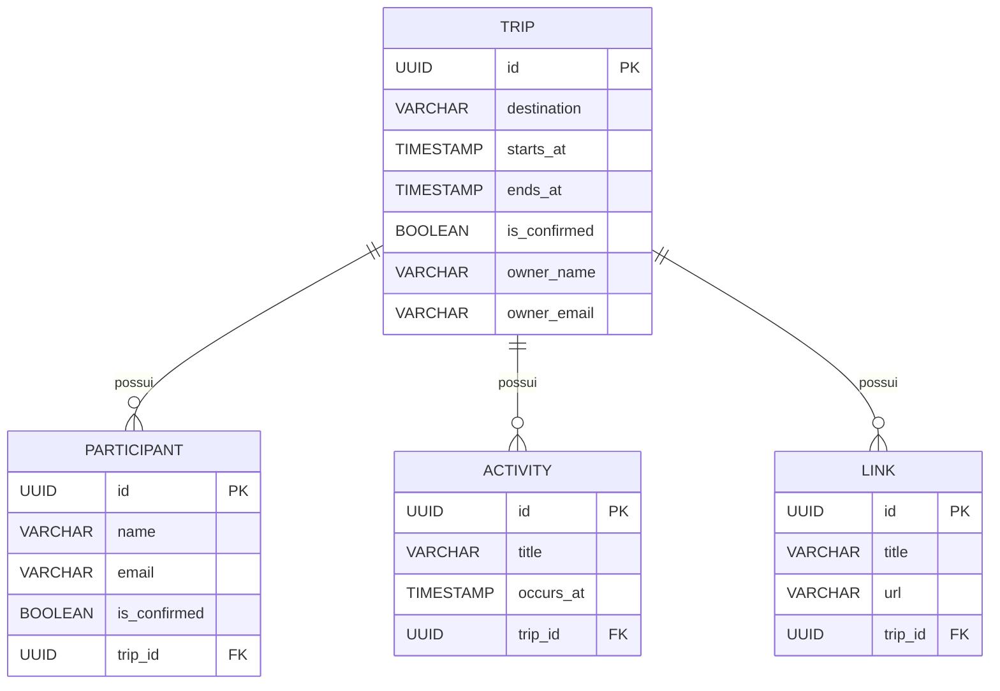

# ✈️ plann.er — Travel Planner API

<p align="center">
  
  
  
  
  
</p>

O **plann.er** é uma API REST corporativa desenvolvida em **Java 21** e **Spring Boot 3** para planejamento e gestão colaborativa de viagens e expedições em grupo.

A plataforma permite cadastrar viagens com controle de itinerário, envio de convites para participantes, confirmação de presença, organização de cronograma de atividades e centralização de links essenciais (passagens, reservas, ingressos). O backend foi projetado com arquitetura em camadas limpas, suporte a CORS para clientes Frontend (como **Angular**) e preparado para extensão com **Inteligência Artificial Generativa (GenAI)** para curadoria de itinerários inteligentes.

---

## 📋 Sumário

- [Tecnologias Utilizadas](#-tecnologias-utilizadas)
- [Estrutura do Projeto](#-estrutura-do-projeto)
- [Modelo de Dados](#-modelo-de-dados)
- [Configuração de CORS](#-configuração-de-cors)
- [Endpoints da API](#-endpoints-da-api)
  - [Viagens (`/trips`)](#1-viagens-trips)
  - [Participantes (`/participants`)](#2-participantes-participants)
  - [Atividades (`/trips/{id}/activities`)](#3-atividades-tripsidactivities)
  - [Links Úteis (`/trips/{id}/links`)](#4-links-úteis-tripsidlinks)
- [Como Executar](#-como-executar)
  - [Pré-requisitos](#pré-requisitos)
  - [Passo a passo](#passo-a-passo)
- [Banco de Dados e Migrations](#-banco-de-dados-e-migrations)
- [Autora](#-autora)

---

## 🚀 Tecnologias Utilizadas

- **[Java 21](https://www.oracle.com/java/)**: Linguagem de programação principal com uso de Records e tipagem moderna.
- **[Spring Boot 3.3.1](https://spring.io/projects/spring-boot)**: Framework base da aplicação.
  - **Spring Web**: Criação de APIs RESTful e configurações de CORS.
  - **Spring Data JPA / Hibernate**: Mapeamento objeto-relacional (ORM) e persistência.
  - **Spring Boot Validation**: Validação declarativa de contratos via Bean Validation.
  - **Spring Boot DevTools**: Recarregamento rápido em ambiente de desenvolvimento.
- **[Flyway Migration](https://flywaydb.org/)**: Versionamento e evolução controlada do schema do banco de dados.
- **[H2 Database](https://www.h2database.com/)**: Banco de dados relacional em memória para desenvolvimento ágil.
- **[Project Lombok](https://projectlombok.org/)**: Redução de boilerplate para entidades JPA.
- **[Apache Maven](https://maven.apache.org/)**: Gerenciamento de ciclo de vida e dependências.

---

## 📁 Estrutura do Projeto

O projeto adota uma arquitetura em camadas bem desacoplada:

```text
src/
└── main/
    ├── java/br/com/barbara/planner/
    │   ├── PlannerApplication.java        # Ponto de entrada da aplicação Spring Boot
    │   ├── controller/                    # Camada de controle REST (HTTP Endpoints)
    │   │   ├── TripController.java
    │   │   └── ParticipantController.java
    │   ├── domain/
    │   │   └── entity/                    # Entidades de Domínio JPA
    │   │       ├── Trip.java
    │   │       ├── Participant.java
    │   │       ├── Activity.java
    │   │       └── Link.java
    │   ├── repository/                    # Interfaces de persistência Spring Data JPA
    │   │   ├── TripRepository.java
    │   │   ├── ParticipantRepository.java
    │   │   ├── ActivityRepository.java
    │   │   └── LinkRepository.java
    │   ├── service/                       # Camada de serviços e regras de negócio
    │   │   ├── TripService.java
    │   │   ├── ParticipantService.java
    │   │   ├── ActivityService.java
    │   │   └── LinkService.java
    │   ├── dto/                           # Data Transfer Objects (Records imutáveis)
    │   │   ├── trip/
    │   │   ├── participant/
    │   │   ├── activity/
    │   │   └── link/
    │   └── infra/
    │       └── config/                    # Configurações globais (CORS, Security, etc.)
    │           └── CorsConfig.java
    └── resources/
        ├── application.properties         # Configurações do ambiente Spring Boot
        └── db/migration/                  # Versionamento de schema com Flyway
            ├── V1__create-table-trips.sql
            ├── V2__creat-table-participant.sql
            ├── V3__create-table-activities.sql
            └── V4__create-table-links.sql
```

---

## 🗄️ Modelo de Dados



---

## 🌐 Configuração de CORS

A aplicação já conta com liberação de CORS em `CorsConfig.java` para comunicação com aplicações Frontend:

- **Origem Permitida:** `http://localhost:4200` (Angular)
- **Métodos Suportados:** `GET`, `POST`, `PUT`, `DELETE`, `OPTIONS`, `PATCH`
- **Cabeçalhos Suportados:** `*`
- **Credenciais:** Habilitadas (`allowCredentials(true)`)

---

## 📡 Endpoints da API

Formato padrão para datas e horários: `ISO-8601` (ex.: `2026-12-25T10:00:00`).

### 1. Viagens (`/trips`)

#### Criar Viagem
- **Método / Rota:** `POST /trips`
- **Requisição:**
  ```json
  {
    "destination": "Florianópolis, SC",
    "starts_at": "2026-12-20T08:00:00",
    "ends_at": "2026-12-27T18:00:00",
    "emails_to_invite": [
      "amigo1@email.com",
      "amigo2@email.com"
    ],
    "owner_name": "Bárbara Brito",
    "owner_email": "barbara@email.com"
  }
  ```
- **Resposta:** `200 OK`
  ```json
  {
    "tripId": "a1b2c3d4-e5f6-7a8b-9c0d-1e2f3a4b5c6d"
  }
  ```

#### Obter Detalhes da Viagem
- **Método / Rota:** `GET /trips/{id}`
- **Resposta:** `200 OK`
  ```json
  {
    "id": "a1b2c3d4-e5f6-7a8b-9c0d-1e2f3a4b5c6d",
    "destination": "Florianópolis, SC",
    "startsAt": "2026-12-20T08:00:00",
    "endsAt": "2026-12-27T18:00:00",
    "isConfirmed": false,
    "ownerName": "Bárbara Brito",
    "ownerEmail": "barbara@email.com"
  }
  ```

#### Atualizar Viagem
- **Método / Rota:** `PUT /trips/{id}`
- **Requisição:**
  ```json
  {
    "destination": "Florianópolis, SC - Praia dos Ingleses",
    "starts_at": "2026-12-21T08:00:00",
    "ends_at": "2026-12-28T18:00:00"
  }
  ```
- **Resposta:** `200 OK`

#### Confirmar Viagem
- **Método / Rota:** `GET /trips/{id}/confirm`
- **Resposta:** `200 OK`

---

### 2. Participantes (`/participants`)

#### Confirmar Participação
- **Método / Rota:** `POST /participants/{id}/confirm`
- **Requisição:**
  ```json
  {
    "name": "Maria Silva",
    "email": "amigo1@email.com"
  }
  ```
- **Resposta:** `200 OK`

---

### 3. Atividades (`/trips/{id}/activities`)

#### Cadastrar Atividade
- **Método / Rota:** `POST /trips/{id}/activities`
- **Requisição:**
  ```json
  {
    "title": "Jantar de Boas-Vindas",
    "occurs_at": "2026-12-20T20:00:00"
  }
  ```
- **Resposta:** `200 OK`

#### Listar Atividades da Viagem
- **Método / Rota:** `GET /trips/{id}/activities`
- **Resposta:** `200 OK`

---

### 4. Links Úteis (`/trips/{id}/links`)

#### Cadastrar Link
- **Método / Rota:** `POST /trips/{id}/links`
- **Requisição:**
  ```json
  {
    "title": "Reserva do Airbnb",
    "url": "https://www.airbnb.com.br/rooms/123456"
  }
  ```
- **Resposta:** `200 OK`

#### Listar Links da Viagem
- **Método / Rota:** `GET /trips/{id}/links`
- **Resposta:** `200 OK`

---

## 🛠️ Como Executar

### Pré-requisitos
- **Java 21 (JDK)** instalado e configurado no `JAVA_HOME`.
- **Maven 3.9+** (ou utilizar o wrapper `./mvnw` / `mvnw.cmd`).

### Passo a passo
1. **Clone o repositório:**
   ```bash
   git clone https://github.com/britobarbara/planner.git
   cd planner
   ```

2. **Execute a aplicação:**
   - **No Linux/macOS:**
     ```bash
     ./mvnw spring-boot:run
     ```
   - **No Windows:**
     ```cmd
     .\mvnw.cmd spring-boot:run
     ```

3. **Acesse a API:**
   ```text
   http://localhost:8080
   ```
   Console do H2: `http://localhost:8080/h2-console` (JDBC URL: `jdbc:h2:mem:plannerdb`)

---

## 💾 Banco de Dados e Migrations

A aplicação utiliza o banco **H2 Database** em memória configurado em `src/main/resources/application.properties`.

- **URL de Conexão:** `jdbc:h2:mem:plannerdb`
- **Usuário:** `sa`
- **Senha:** *(vazia)*

O controle do schema é automático através do **Flyway**, que aplica as migrations localizadas em `src/main/resources/db/migration` assim que a aplicação é inicializada.

---

## 👩‍💻 Autora

Desenvolvido por **[Bárbara Brito](https://github.com/britobarbara)**.
